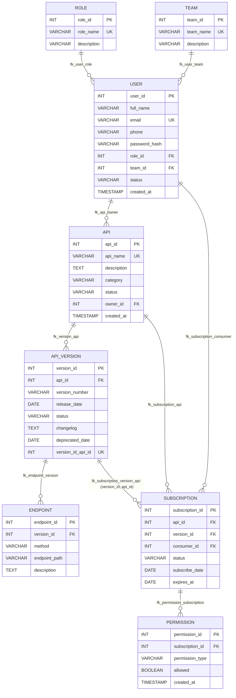

# Database ER Diagram

This diagram follows the DDL in `sql/api_management_refined.sql`. It includes all eight base tables, their declared attributes, primary keys, unique keys, foreign keys, and the subscription-to-version composite relationship.

## Relationship and key notes

- Each `USER` must refer to exactly one `ROLE` and one `TEAM`; a role or team may have zero or many users.
- Each `API` has one owner (`USER`). An owner may own zero or many APIs.
- Each `API_VERSION` belongs to one `API`; an API may have zero or many versions.
- Each `ENDPOINT` belongs to one version; a version may have zero or many endpoints.
- A `SUBSCRIPTION` refers to one API, one version, and one consumer user. Each of those parent records can be referenced by zero or many subscriptions.
- `fk_subscription_version_api` is composite: `(SUBSCRIPTION.version_id, SUBSCRIPTION.api_id)` references `(API_VERSION.version_id, API_VERSION.api_id)`. This prevents a subscription from combining an API with another API's version. `API_VERSION` declares a unique key on `(version_id, api_id)` to support this relationship.
- A subscription may have zero or many `PERMISSION` rows. The pair `(subscription_id, permission_type)` is unique, so a permission type can occur at most once per subscription.
- `UK` means a declared unique key. The ER notation's `version_id_api_id` label represents the unique pair `(version_id, api_id)`, not a separate stored column.
- The diagram shows declared foreign-key relationships only. Views, triggers, functions, and procedures are database objects, not entities in this ER model.
